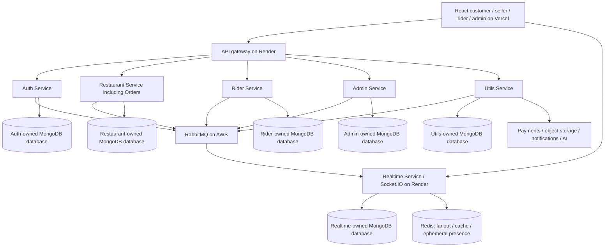

# CraveCart implementation plan

## 1. Architecture and service ownership

Use a TypeScript monorepo for shared contracts and tooling, with six independently built/deployed Express services. MERN remains the application stack; Redis, RabbitMQ and object storage are supporting infrastructure.



Arrows simplify the diagram; all event consumers connect to RabbitMQ, and service-owned databases may initially be logical databases on one production replica-set cluster with separate credentials. An ingress proxy/gateway and worker processes are deployment infrastructure, not additional domain services.

| Service | Owns | Must not own |
|---|---|---|
| Auth | Identities, sessions, contact challenges, role grants, MFA, privacy request intake | Menu, order/payment state, seller/rider domain verification decisions |
| Restaurant | Restaurants, seller applications/memberships, catalog, service zones projection, customer addresses/cart/favorites, quotes/reservations/promotions, order authority, reviews | Capturing money or assigning riders |
| Rider | Rider applications/profiles, availability, offers, exclusive assignments, location acceptance, delivery incidents | Final order state or direct payment ledger mutation |
| Admin | Verification cases, admin grants/policies, configuration versions, audit trail, operational read projections | Direct writes into other databases |
| Realtime | Socket authorization, subscriptions, conversation messages, fanout, connection health | Financial/business state as socket-only data |
| Utils | Payment adapters, webhook inbox, refunds, financial ledger/statements, upload lifecycle, notifications, support tickets, chatbot orchestration/FAQ retrieval | Bypassing domain permissions or initiating unconfirmed AI actions |

Utils contains isolated packages and worker pools for payments, uploads, notifications, support and AI. Set separate concurrency/resource budgets so AI latency cannot starve payment processing. Start with six deployable services as requested; extract Order, Payments or Assistant into separate services only when measured ownership/scale warrants migration.

## 2. Technology baseline

| Layer | Choice and strategy |
|---|---|
| Runtime | Supported Node.js LTS verified at kickoff; pinned patch/image digest and lockfile |
| Frontend | React + TypeScript + Vite, React Router, TanStack Query for server state |
| Local state | Zustand or small context stores for UI state; never duplicate financial truth |
| UI/forms | Tailwind or CSS tokens plus accessible primitives; React Hook Form + Zod |
| Backend | Express + TypeScript, explicit controller/domain/repository boundaries |
| Persistence | MongoDB replica set; native driver for shared transaction/outbox infrastructure, domain model choices recorded per module; explicit migrations/index deployment |
| Messaging | RabbitMQ AMQP client with confirms/manual acks, durable domain queues |
| Realtime/cache | Socket.IO; compatible Redis adapter chosen after recovery/scaling validation; Redis GEO for ephemeral proximity candidates |
| Search | MongoDB indexed text/geospatial search initially; advanced search as optional Atlas capability |
| Files | S3-compatible private object storage; purpose-scoped signed URLs; scanner/quarantine worker |
| Tests | Vitest, HTTP integration tests, Playwright E2E, containerized real dependencies, k6 load tests |
| Telemetry | Structured JSON logs, OpenTelemetry trace propagation, metrics/dashboards, frontend error monitoring |
| Packaging | Multi-stage non-root Docker images, Compose for local development, infrastructure configuration in version control |

Resolve current compatible versions from official sources at implementation kickoff. This plan intentionally avoids guessing future package versions or pricing.

## 3. Repository structure

```text
apps/
  web/                       # React route shells and feature modules
services/
  auth/
  restaurant/
    src/modules/catalog/
    src/modules/cart/
    src/modules/orders/      # exclusive order state authority
    src/modules/sellers/
  rider/
  admin/
  realtime/
  utils/
    src/modules/payments/
    src/modules/uploads/
    src/modules/notifications/
    src/modules/support/
    src/modules/assistant/
packages/
  contracts/                 # HTTP, events, socket schemas and generated clients
  auth-policy/               # verification helpers; domain policies stay with owners
  config/
  observability/
  ui/
  test-fixtures/
infra/
  compose/
  render/
  rabbitmq/
  runbooks/
docs/
```

Shared packages contain interfaces and small utilities; never import another service's repository/models or deploy shared code as a hidden shared database layer.

## 4. Data design and indexes

All persistent entities carry ID, createdAt, updatedAt and appropriate version. Use UTC storage, explicit market timezone, soft deletion only when policy requires it, and documented retention. Avoid unbounded arrays on hot documents.

| Owner | Collections / important fields | Required indexes/invariants |
|---|---|---|
| Auth | users, sessions, challenges, roleGrants, privacyRequests | Unique normalized verified contacts via partial indexes; hashed token IDs; TTL on challenges/session cleanup; enforce expiry in code |
| Restaurant | restaurants, sellerApplications, memberships | Unique slug; `2dsphere` location; restaurant+user membership unique; status/zone query indexes |
| Restaurant | categories, menuItems, menuReservations | Restaurant/category/order indexes; reservation expiry index and worker; atomic capacity checks |
| Restaurant | addresses, carts, favorites | User+updatedAt; one active cart/user; user+restaurant favorite unique |
| Restaurant | quotes, promotions, redemptions | Quote expiry; unique redemption reservation key; bounded usage counters |
| Restaurant | orders, orderTransitions | Customer+createdAt; restaurant+status+createdAt; unique order+transition version; idempotency key unique by scope |
| Rider | riders, applications, deliveryTasks, offers, locations | Unique active task per rider/order via suitable partial indexes; offer expiry; assignment version; location retention TTL |
| Utils | paymentAttempts, webhookInbox, refunds | Provider+event ID unique; provider payment ID unique; business refund key unique; order+attempt sequence |
| Utils | ledgerEntries, settlements, statementJobs | Immutable balanced posting groups per currency; unique business posting key; settlement period/party |
| Utils | uploads, notifications, tickets, ticketMessages | User+createdAt; ticket+sequence unique; object lifecycle status |
| Utils | assistantConversations, messages, toolActions, faqVersions | Owner+createdAt; confirmation hash/expiry; usage budgets; content publication version |
| Realtime | conversations, messages, readCursors | Order participant scope; conversation+message sequence; sender+clientMessageId unique |
| Admin | verificationCases, operations, configVersions, auditRecords, projections | Entity+version unique; case state; actor+time; tamper-evident audit export |
| Every event-producing owner | outbox, processedEvents, idempotencyRecords | Unique eventId; unique consumer+eventId; nextAttemptAt/status index; bounded retention |

Orders embed immutable item/modifier/unit-price/address/policy snapshots. Financial entries record debit/credit accounts, currency, minor-unit amount, provider reference and business event; corrections are compensating entries, never silent edits. Tips, commissions, refunds and chargebacks are explicit entries. Avoid interpreting gross captured money as platform revenue.

Provisional retention: raw task location 7 days, assistant content 30 days unless saved into a ticket with consent, diagnostic logs 30 days. Financial, support, verification and audit retention must be set by approved market policy before launch; do not encode arbitrary legal periods. Deletion workflows traverse owners and retain only justified minimum records with pseudonymized references where required.

## 5. Consistency and message reliability

### Transactional outbox

1. Validate authenticated actor, idempotency key, payload hash and expected version.
2. In one owner-database transaction, persist domain changes, transition history, command result and outbox event.
3. Outbox worker claims a lease, publishes persistent messages with publisher confirms and unroutable-message detection, then records delivery. Lost confirms cause safe retry.
4. Consumer inserts a unique processed-event record and applies local effects in a local transaction; ack only after commit.
5. Network/provider effects run through durable operation records with stable provider idempotency/business keys and reconciliation. A database transaction cannot atomically include an external gateway call.
6. Retry transient failures with exponential backoff/jitter using separate retry queues; after a bounded budget, route to DLQ with alert. Never continuously requeue poison messages.
7. Replay tools require operator authorization, audit, preserved event identity, schema compatibility and idempotent consumers.

Delivery is at least once, not an end-to-end exactly-once guarantee. Correctness comes from deduplication and business invariants. [RabbitMQ reliability reference](https://www.rabbitmq.com/docs/reliability).

### Checkout/payment saga

1. Validate serviceability, restaurant status, item/modifier availability and offer eligibility; calculate an expiring server quote.
2. On explicit checkout, reserve quantity/promotion usage in Restaurant Service and create a payment-pending order and outbox event atomically.
3. Utils creates a durable payment attempt, loads the verified payable order internally, chooses configured gateway/currency, and creates its provider session with a stable business key. Serialize payable attempts and reconcile uncertain provider calls before creating a replacement.
4. Provider return proofs and signed webhook events feed the same payment reducer; verify provider account, order/attempt reference, currency, amount and captured status. Persist webhook inbox before acknowledging receipt; process asynchronously.
5. Publish captured outcome; Restaurant atomically transitions eligible order to placed and commits reservations. If deadline/cancellation already won, do not place the order: queue compensation.
6. A durable expiry/reconciliation worker queries pending attempts before releasing reservations under an explicit time policy. Late captured funds always become a refund/exception workflow.
7. On rejection/cancellation, durable refund intent plus approval rules lead to provider submission. Mark refunded only after verified provider outcome; escalate stuck/failed refunds.
8. Scheduled jobs reconcile provider captures, refunds, disputes and settlement records against internal ledger/order records. Alert on unmatched amounts, currency, missing orders and duplicate provider references.

Razorpay and Stripe have different verification and idempotency protocols; implement adapter-specific behavior instead of assuming identical headers or SDK methods. Validate signatures over the unmodified body and deduplicate authenticated deliveries. [Razorpay reference](https://razorpay.com/docs/webhooks/validate-test/), [Stripe reference](https://docs.stripe.com/webhooks).

### Dispatch and delivery saga

- Start dispatch after seller acceptance using preparation estimate; score eligible online approved nearby riders using pickup distance, active workload and fairness. The current implementation uses MongoDB GEO for durable candidate selection and Redis for short-lived location caching. A future qualified route provider can supply pickup ETA; distance is not presented as a road-route ETA. Durable assignment checks remain authoritative.
- Use configurable search radius expansion, offer expiry, decline cooldown, capped retries and no-rider escalation. Initial defaults: 20-second offer, three search rounds; tune from pilot evidence.
- Accept performs transactional conditional writes with unique active-assignment constraints and confirms that the order is still eligible. Cross-service cancellation races trigger idempotent withdrawal before pickup; do not claim a global transaction exists.
- Rider pickup/completion commands create durable pending operations. Restaurant validates current authoritative order state, assigned rider and verification proof, then emits applied/rejected outcome. UI may show “confirming”; it cannot claim completed delivery on a queued request alone.
- Delivery OTP is generated server-side, stored hashed, expiry/attempt-limited, and supplied only to the entitled party. Override requires documented support approval and audit.
- Customer unavailable/failed delivery and post-pickup incidents require time-boxed operational decisions. Never automatically reassign food already in transit as if it remained at the restaurant.

## 6. Realtime and maps strategy

- Persist all important state before Socket.IO emission. Clients apply monotonic versions, ignore duplicates and refetch on gaps.
- On reconnect, reauthenticate, authorize rooms, fetch order snapshot and resume notification/message cursors. Bounded polling is the fallback. Socket recovery alone is insufficient because default delivery is at most once. [Socket.IO reference](https://socket.io/docs/v4/delivery-guarantees/).
- Use one realtime instance during early development. Before horizontal scaling, validate adapter support, room fanout, recovery and load balancer behavior. If long-polling is enabled, configure and test session affinity; otherwise explicitly test WebSocket-only transport and its fallback UX.
- Initial foreground GPS cadence: approximately 3–5 seconds while moving, 15 seconds stationary; adapt to accuracy, battery and network. These are configurable targets, not guaranteed browser timers.
- Validate coordinates, sample age, assignment, sequence, plausible speed and accuracy. Keep capture and receive times. Label low accuracy and staleness; never accept a location as proof of delivery by itself.
- Latest locations live in Redis with TTL; persist downsampled task-scoped history under retention policy. Do not send every GPS sample through durable order queues.
- Maps adapter exposes geocode, reverse geocode, route and ETA. Cache within provider terms, restrict browser keys by domain/API and server keys by environment, add quotas and budget alerts.
- Display route estimates and freshness. External navigation deep links use validated coordinates for the current pickup/drop stage. Reroute requests are throttled; never query paid routing per GPS tick.
- GPS permission denial offers manual address entry for customers and explicit rider offline/limited-tracking guidance. Use HTTPS. [Geolocation reference](https://developer.mozilla.org/en-US/docs/Web/API/Geolocation_API).
- Enable sound only following user interaction; persist preference, deduplicate by notification ID, stop repeated alerts after acknowledgement and always show a visible signal. [Autoplay reference](https://developer.mozilla.org/en-US/docs/Web/Media/Guides/Autoplay).

## 7. Frontend implementation strategy

1. Establish shared design tokens and accessible button/form/dialog/table/status primitives, with CraveCart branding and licensed assets.
2. Implement route shells and role-aware navigation from a typed manifest. Each entry declares route pattern, permitted workspace, breadcrumb, data loader and owning feature.
3. Generate API clients from contracts. TanStack Query owns server state/cache keys including user/workspace/restaurant scope; clear sensitive caches on logout/role change.
4. Use shared error handling with safe messages and request IDs. Keep irreversible operations pending until the server confirms; disable duplicate submits but retain server idempotency.
5. Store search/filter state in URL; protect unsaved forms; persist cart server-side and merge guest cart explicitly after login.
6. Implement responsive layouts and all empty/offline/loading/error states before styling extra dashboards.
7. Use test-only fixtures with deterministic accounts and orders. Demo banners identify simulated data; production rejects fake gateway/provider configuration.
8. Register analytics by stable event names and consent settings. Do not send addresses, payment references or message content to general analytics.

## 8. Chatbot implementation strategy

- Build deterministic FAQ/order-status tools first; add model wording only after authorization and retrieval work independently.
- Maintain approved FAQ content with version/source/expiry. Small initial corpora can use indexed search; embeddings/vector search are an optional retrieval layer, not required for every answer.
- Model adapter accepts sanitized context, strict tool schemas and budget; API credentials remain server-side.
- Read tools: `searchPublishedMenu`, `getOwnOrderStatus`, `getOwnRefundStatus`, `getApprovedPolicy`, scoped seller/rider help. Query current facts rather than using model memory.
- Proposed write tools: `proposeCartChange`, `proposeSupportTicket`; execute only through confirmed standard domain commands. No model tool can initiate financial or privileged administrative actions.
- Version prompts, tool schemas, model configuration and evaluation datasets. Compare quality/cost/latency before changing providers or models.
- Use SSE with abort/cancellation, per-user concurrency, graceful timeout, provider circuit breaker and fallback FAQ/support links.
- Evaluate role/ownership attacks, instruction injection, unsupported allergy statements, stale menus, nonexistent order IDs, incorrect refund claims and invalid navigation links. Log tool outcomes with redacted metadata.

## 9. Security and privacy strategy

- Short-lived access credentials, rotated server-stored refresh sessions, secure HttpOnly cookies on a controlled first-party domain setup, exact CORS allowlist, CSRF protection and HTTPS/HSTS.
- Prefer `app.cravecart.<owned-domain>` and `api.cravecart.<owned-domain>` with explicit cookie scope; if cross-site cookies are unavoidable, document SameSite behavior, CSRF protection and browser restrictions. Never assume arbitrary Vercel/Render default domains share cookie context.
- Admin MFA and privileged step-up; bootstrap first admin through a one-time audited operator procedure, never a public route or production seed password.
- Service-to-service identity using rotated audience-bound credentials or mTLS; private routing alone is not authorization.
- Rate limits at edge and owner service for auth, OTP, search, chat, payments, GPS and exports. Apply body/query limits and schema validation to prevent injection and resource abuse.
- Upload content checks, MIME sniffing, size/type allowlists, random object keys, malware scan, quarantine and private KYC objects. Restrict remote URL ingestion to avoid SSRF.
- Use a dedicated managed secret store/platform secret settings; no secrets in frontend bundles, images, logs or repository. Rotate/signing-key drills and dependency/container scanning are CI requirements.
- Redact PII from logs/traces; access to customer contact/address is task scoped and time limited. Audit verification-document and finance access.
- Consent, export and deletion workflows span services, object storage and derived indexes. Approve applicable privacy/payment/tax/food-safety obligations with qualified operators before launch; this document is not a compliance certification.

## 10. Deployment and operating strategy

### Local and CI

- Docker Compose runs six services, gateway, MongoDB replica set, RabbitMQ and Redis, plus local mail/payment/map fakes under an explicit development profile.
- `.env.example` contains placeholders only. Document environment variables and fail fast when required production values are absent.
- CI on every change: formatting/lint, typecheck, domain unit tests, owner integration tests, contract validation, build and relevant Playwright journeys. Main/release additionally scans dependencies/images and runs deployment smoke tests.
- Never let a preview environment connect to live payment secrets or production customer data. Separate provider webhook URLs, queues, DB credentials and storage buckets per environment.

### Production topology

- Vercel serves the React SPA. Render runs the public gateway and realtime web service; remaining domain services use eligible private services and durable background workers as appropriate. Use paid always-on capacity sized by measurements.
- A MongoDB replica set supports transactions/outbox, backups and point-in-time recovery. Redis is configured with availability and eviction policies appropriate to each usage; it is not the financial source of truth.
- AWS-hosted Docker RabbitMQ uses durable volumes, TLS, restricted network access, per-service users/vhosts and monitored disk/memory/queue capacity. Keep management access behind controlled operator access.
- One broker node is acceptable for local/pilot environments but is a production availability risk. For the HA target, qualify a multi-node quorum-queue deployment across failure domains, or an approved managed RabbitMQ alternative, and test node loss. Running containers on one host is not HA.
- Render private networking does not automatically reach AWS. Validate a supported private connectivity option or narrowly restricted TLS ingress from documented egress sources; if this cannot be secured, revise the topology before launch. Domain queue consumers must demonstrate reliable broker access before feature rollout. [Render networking reference](https://render.com/docs/private-network).
- Render deployments can close WebSocket connections, so rehearse graceful drain and client resubscription. [Render WebSocket reference](https://render.com/docs/websocket).

### Release and recovery

- Deploy backwards-compatible consumers first, then producers; additive contract changes before removals. Version breaking events/HTTP APIs.
- Run expand/contract migrations with backup and dry run. Index builds and backfills are explicit jobs, not automatic startup surprises.
- Use staging smoke tests, feature flags and gradual city/restaurant cohorts. Roll back application images independently; financial corrections use compensating workflows.
- Graceful shutdown stops new requests, stops claiming queue work, completes/returns in-flight work safely, drains sockets and closes connections within platform deadlines.
- Keep runbooks for provider outage, stuck webhook, DLQ, no riders, stale tracking, document incident, refund backlog, database restore, compromised key and rollback.
- Cost model before launch covers Vercel bandwidth, six services/workers, broker cluster/storage/egress, MongoDB, Redis, maps routing/geocoding, OTP, push/email, AI, object storage, monitoring and gateway fees. Use current vendor quotes and load measurements; no unverified monthly total is promised.

## 11. Delivery roadmap

The runtime now covers identity/onboarding, national discovery, verified seller catalogs, server-priced checkout, signed payment/refund workflows, exclusive dispatch, foreground tracking, four-role operations and the grounded assistant. Hardening adds security/drain fixes, automated accessibility, release evidence, transport and restore verification tools, and incident runbooks. See [executed verification](engineering/VERIFICATION.md) and [pilot readiness](release/PILOT-READINESS.md). Hosted qualification remains open; automated implementation evidence does not mark the full product launched.

Estimate: **18–24 weeks** for the baseline team described in the planning index, with some tracks overlapping. A solo build should be re-estimated by capacity rather than assuming the same date. Provider verification, native tracking, security remediation and operational setup can extend the schedule.

| Phase | Indicative window | Concrete deliverables | Exit gate / dependency |
|---|---|---|---|
| 0. Discovery and contracts | Weeks 1–2 | Confirm market/policies, journey maps, design system, route manifest, OpenAPI/event baseline, ADRs, provider-account applications | Reviewed requirements; acceptance IDs; architecture/network feasibility |
| 1. Foundation | Weeks 2–4 | Monorepo, Compose, CI, contracts, gateway, six health-ready services, logging/traces, replica-set transactions, outbox/inbox skeleton | Clean checkout runs; event replay/dedup works; staging reachable |
| 2. Identity and onboarding | Weeks 4–6 | Four workspace shells, auth/session/MFA, seller/rider applications, uploads/scan, admin verification | Cross-role/object access tests pass; no privileged self-signup |
| 3. Discovery and catalog | Weeks 6–8 | Address/location/serviceability, menus/modifiers, seller management, search/favorites/offers, responsive states | Customer can build valid cart; sellers scoped; navigation audit |
| 4. Orders and money | Weeks 8–11 | Quotes/reservations, order state machine, Razorpay and Stripe adapters, signed webhook inbox, refunds, ledger/reconciliation | Duplicate/reordered/late payment race tests pass for both gateways |
| 5. Fulfillment and tracking | Weeks 10–14 | Seller board, dispatch exclusivity, rider task flow, OTP, maps, GPS, realtime recovery, sound/inbox/push | Multi-actor real-device journey, no double assignment, stale/reconnect handling |
| 6. Full role operations | Weeks 13–16 | Support messaging, reviews, finance statements, admin reports/zones/promotions/staff/audit | Each P1 route has real data and complete action/error states |
| 7. Assistant | Weeks 15–17 | Grounded FAQ, scoped tools, cart proposal, confirmation, human handoff, evaluation suite | Grounding/security targets; provider-down fallback; cost limits |
| 8. Hardening and pilot | Weeks 17–21 | Full E2E, accessibility, threat review, capacity/fault tests, broker/database restore, runbooks, finance balancing | Quality checklist signed with evidence; no critical unresolved failures |
| 9. Launch preparation | Weeks 21–24 | Limited city pilot, seller/rider training, support/on-call, gradual rollout, live gateway smoke, follow-up fixes | P0/P1 acceptance and operational release gates passed |

The orders/money runtime is implemented locally; see [checkout and financial operations](engineering/ORDERS-AND-PAYMENTS.md). Provider fixtures and development browser flows are local evidence. Actual hosted gateway, broker, settlement and production release qualification remain open; this status does not authorize live rollout.

Native rider background capability, if selected, starts in phase 2 alongside the web build and must pass physical screen-off tests before continuous tracking is advertised. It is a companion to the MERN backend/frontend, not something a browser permission can replace.

Hosted fulfillment implementation now connects merchant order actions, bounded rider dispatch, authoritative pickup/completion, GPS, authenticated Socket.IO and notification recovery. See [fulfillment and tracking](engineering/FULFILLMENT-AND-TRACKING.md) and [Vercel/Render hosting](engineering/HOSTING.md). Hosted execution, real provider callbacks, physical devices, load and operational qualification remain open until supported by evidence.

### Dependency order

Role operations now include support conversations, active-delivery messages and moderation, verified reviews with derived ratings, scoped restaurant teams, limited administrative permission bundles, paginated history, India-period reports, audited aggregate exports and explicit accounting-record views. See [runtime scope and limits](engineering/ROLE-OPERATIONS.md). Settlement/compensation contracts and provider reconciliation remain open gates; recorded customer charges are not inferred to be partner earnings. The grounded assistant and repository hardening are implemented; see [assistant scope](engineering/ASSISTANT.md), [hardening](engineering/HARDENING.md) and [incident runbooks](engineering/INCIDENT-RUNBOOKS.md). The hardening exit gate remains pending actual hosted recovery/capacity/provider/device evidence and accountable pilot sign-off. Launch preparation must respect those gates.

`Contracts → identity/ownership → catalog/serviceability → authoritative quote → payment/order saga → seller fulfillment → exclusive dispatch → verified delivery → statements/reconciliation`.

Realtime depends on durable state and authorization. The assistant depends on trustworthy domain tools. Admin reporting depends on validated event projections and metric definitions. A broker/database/network failure drill depends on working observability first.

## 12. Engineering decisions and risk register

Launch preparation is now implemented in the repository: real merchant launch approvals/revocation, account and partner management routes, privacy-request intake, consistent deployment fingerprints, strict read-only hosted preflight, scoped rollout/observation gates, partner training and an operating handoff packet. See [launch handbook](release/LAUNCH-HANDBOOK.md). The owner will provision hosting. Actual hosted provider/device/load/recovery acceptance, reviewed policies, staffed coverage and live pilot operation remain external exit gates; they are not replaced with fixture results.

Record ADRs for service ownership, six-service constraint, session/cookie topology, outbox/inbox, pricing snapshots, payment saga, exclusive dispatch, socket adapter, location privacy, maps selection, AI tooling and HA networking.

| Risk | Prevention | Trigger and response |
|---|---|---|
| Six services slow early delivery | Shared tooling/contracts, feature slices, bounded modules | Track integration lead time; simplify internals without sharing DB ownership |
| Duplicate/out-of-order payment events | Durable inbox, verified reducer, unique keys, reconciliation | Unmatched captures alert; pause affected gateway if correctness uncertain |
| No riders or seller delays | Capacity zones, prep-aware dispatch, timeouts | Operations alert, pause ordering or offer policy-based cancellation |
| Browser stops rider GPS | Explicit foreground pilot scope; native companion | Stale label and support workflow; no false continuous-tracking claim |
| Cross-cloud RabbitMQ outage/cost | Early connectivity spike, TLS, HA, measured latency/egress | Durable outbox backlog alert; stop unsafe transitions; restore/reconcile |
| AI fabricates or leaks context | Scoped tools, retrieval, confirmation and attack evaluations | Disable tool flag/provider and keep FAQ/support usable |
| Seller/rider payouts unavailable | Early merchant/payout onboarding and ledger separation | Do not display paid status or enable unsupported market |
| Scope/timeline pressure | P0/P1 gates and demonstrable vertical slices | Re-estimate scope/date explicitly; never relabel a demo as production |
