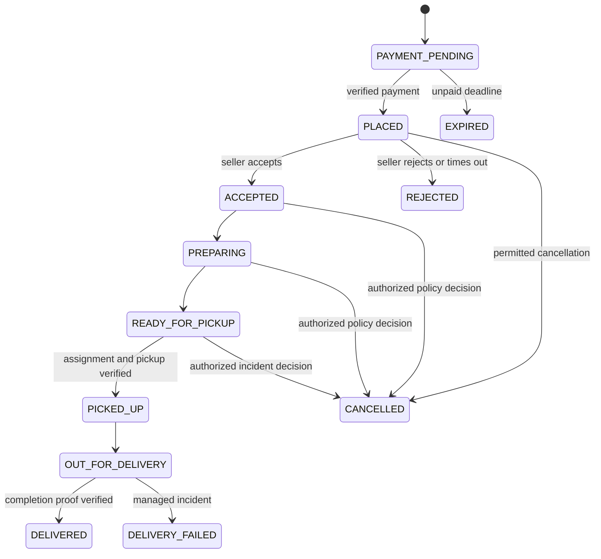

# CraveCart product requirements

## 1. Product outcome

Build a realistic food-delivery marketplace in which customers discover restaurants, pay, and track delivery; restaurant operators manage menus and fulfillment; riders accept and complete deliveries; and administrators verify participants and resolve operational issues. An authenticated assistant helps users discover food and understand their own orders using verified data.

The complete product must include six independently deployable Node.js services, RabbitMQ, Socket.IO, Docker, Razorpay, Stripe, seller/rider/admin/customer dashboards, navigation, sound alerts, and a chatbot. A polished demo is an intermediate milestone, not evidence of production readiness.

The operating scope is **India-wide**, superseding the earlier Chennai-only pilot decision. City discovery is nationwide; delivery availability is determined by approved city-specific zones, restaurant capacity and rider availability. A city-directory entry must never be presented as proof that ordering is live there.

The global market configuration holds country, currency and timezone. Selected city belongs to discovery/address context, not a hardcoded global city. Zone records must include country, city identifier, polygon, operating hours, fee-policy version and activation status. Catalog and checkout validate both city context and exact delivery coordinates; inactive/unconfigured zones fail closed.

## Hosted end-to-end delivery requirements

Updated 25 October 2026 from the supplied customer discovery references.

- Deploy the React frontend on Vercel and the gateway plus six MERN services on Render. MongoDB, RabbitMQ and Redis must use hosted TLS endpoints. Uploaded files must survive deployment on private persistent storage; production must never depend on `.local`, development codes, fictional restaurants, simulated rider locations or development payments.
- Customer sign-in uses the shared CraveCart authentication UI and opens a location-aware discovery page: compact header/search, delivery-focused navigation, circular cuisine inspiration, merchant cards, accurate filters and real published seller menus. Dining/nightlife may only show real supported content; unsupported tabs must not promise booking or invent venues, ratings, discounts or delivery estimates.
- Restaurant sign-in uses the same visual identity and opens owned restaurant management and incoming orders. Approved sellers can publish restaurant details, images, hours and dishes/modifiers; customer discovery reads that same catalog. Paid orders appear on the correct seller board.
- Delivery is an explicit authoritative sequence: PAYMENT_PENDING → PLACED → ACCEPTED → PREPARING → READY_FOR_PICKUP → PICKED_UP → OUT_FOR_DELIVERY → DELIVERED. Rejection before pickup releases reservations and authorizes compensation. Customer cancellation is evaluated by current policy and cannot cancel food in transit.
- Dispatch starts only after the merchant marks the cooked, packed food `READY_FOR_PICKUP`. Acceptance and preparation keep dispatch `WAITING`; the owner rejects assignment and administrative dispatch retry before readiness. Only approved, active, online riders with recent accurate foreground GPS can receive nearby offers. Offers expire, declined candidates cool down, radius expands in bounded rounds and no-rider cases become visible operational exceptions. One order has one active assignment and one rider has one active task; concurrent accepts and cancellation must converge without double assignment.
- Riders see pickup details before pickup; private customer drop-off/contact data is restricted to the assigned active delivery. Pickup and completion require separate server-generated, expiring, attempt-limited codes shared by the entitled restaurant/customer. GPS is never proof of delivery. Lost HTTP responses retain pending operations and reuse the same command identity.
- Customer tracking uses authorized Socket.IO snapshots and a polling fallback. Reconnection reauthenticates and reloads authoritative state. Show location freshness and accuracy; revoke rider-location access when the delivery ends. Navigation opens a validated pickup/drop destination; no straight line is presented as a routed ETA.
- Sound is opt-in after interaction, deduplicated by event identity, and paired with visible notifications. Important notifications survive reload. GPS denial, offline rider, expired offer, wrong code, no rider, stale tracking and provider outages have actionable states.
- Production configuration uses sandbox gateway keys initially until live charging is explicitly approved. API keys belong in hosting secret settings. Actual hosting remains pending account/project/domain access and provider credentials; configuration and automated tests are not evidence of deployment.

Acceptance: a real customer can find a seller-created dish, check out with verified gateway payment, see merchant acceptance/preparation, track an exclusively assigned rider, share the delivery code, and observe confirmed delivery in all three workspaces. Automated tests must cover ownership, races, expiry, invalid proofs, stale GPS, reconnect and refund compensation. Physical screen-off/background tracking requires a native companion and remains outside the foreground MERN web guarantee.

## 2. Scope and priority

### Connected workspace access

`/access` is the shared entry point for four distinct workspaces: customer, restaurant, delivery partner and administration. The reference image describes the connected operating workflow; its layout, styling, identities and sample order values are not design requirements. CraveCart retains its own visual design.

Restaurant approval is an administrative responsibility, not a fifth public role. Restaurant and rider registration begins an application; it never grants operational access. The admin reviews evidence and approves, rejects or requests changes with an audited reason. Restaurant verification and permission to accept live orders remain separate controls. There is no public admin registration or shared default admin password.

Guest entry links open the appropriate verified-contact login or registration. Signed-in users switch only to granted workspaces through the authenticated workspace endpoint; additional partner roles lead to onboarding. Admin landing destinations follow the current permission bundle, including support-only and knowledge-only staff, rather than assuming every staff member can inspect verification records.

Acceptance evidence must follow the full persisted journey: separate customer, restaurant, rider and admin sessions; application review; restaurant-created menu; customer payment confirmation; kitchen acceptance/preparation; exclusive rider assignment; pickup proof; authorized tracking; delivery proof; and delivered status across participants. Provider sandbox fixtures establish application behavior, not real merchant activation or bank settlement. Razorpay Route is the selected India partner payout provider; account activation and the remaining compensation/settlement integration must be completed before claiming bank payout support.

### Role-operation implementation requirements

- Support tickets use requester ownership, optional authorized order links, versioned replies, persistent paginated history and explicit closure. Support operators need separate read/write grants; resolution requires fresh MFA and a visible reason. A support resolution does not execute a financial or fulfillment command.
- Customer–rider messages belong to the current authorized order participants. Sending is permitted during an active assigned delivery; completion closes sending while entitled history remains readable. Messages are rate-limited, rendered as text and reportable. Administrative moderation preserves protected originals and an owner audit.
- One review per delivered customer order is enforced transactionally. Public ratings aggregate only visible verified reviews in the current environment. Restaurants may respond; operators may hide or restore with version, reason and MFA. No customer contact details appear in public reviews.
- Restaurant owners can add approved seller accounts as kitchen or manager colleagues for a specific restaurant. Kitchen access does not allow menu, finance or team changes. Managers may edit catalogs and review responses; owner-only finance and access administration remain enforced. General unverified staff invitations are future scope.
- Governance operators assign allowlisted support, analyst, read-only finance, auditor or operations bundles to existing verified accounts. Changes revoke target sessions. Self-change and modification/suspension of bootstrap governance accounts are denied through ordinary UI. Arbitrary permission strings are rejected.
- Reports identify India date boundaries, generation time, mode and metric definitions. Queries span at most 93 inclusive calendar days. Order-created-date cohorts use current authoritative states and do not claim historical event-time revenue. Administrative aggregate exports require fresh MFA, reason and an audit identity.
- Financial records distinguish captured/refunded values and recorded delivered-order tips from commission, net payable and completed bank settlement. Until compensation agreements and provider reconciliation are configured, commission/payable remain null and settlement status remains UNRECONCILED. Rider records exclude customer capture/refund details. CSV downloads identify their page scope.
- Promotion oversight operates on real merchant-funded offers with version, reason and fresh MFA. Operating-zone and versioned pricing-policy controls continue through the existing domain endpoints. Broader platform-funded campaigns, custom compensation contracts and automated bank payouts need separate implementation/qualification.

Implementation and acceptance evidence: [role operations](engineering/ROLE-OPERATIONS.md). Cross-service retention/deletion, real support staffing and hosted qualification remain launch requirements. The implemented assistant scope is documented in [assistant runtime](engineering/ASSISTANT.md).

**P0:** Required for a safe end-to-end pilot. **P1:** Required for the complete requested release, after P0 stabilizes. **P2:** Explicit future expansion.

| Area | P0 pilot | P1 full release | P2 expansion |
|---|---|---|---|
| Identity | Four roles, OTP/contact verification, sessions, account recovery, admin MFA | Seller staff permissions, session management UI | Enterprise SSO |
| Discovery | Location, nearby restaurants, search, filters, menu, modifiers | Favorites, reviews, recommendations, richer offers | Sponsored discovery |
| Ordering | One-restaurant cart, quote, Razorpay payment, order lifecycle, cancellation/refund | Stripe adapter/live market where eligible, reorder, receipts | Scheduled and multi-restaurant orders |
| Sellers | Verification, restaurant profile, menu, availability, order handling | Analytics, finance statements, staff management | Multi-branch chain controls |
| Riders | Verification, availability, dispatch, pickup/drop OTP, foreground location | Earnings statements, delivery history, operational exceptions | Batch deliveries and route optimization |
| Operations | Approvals, live orders, support, refunds, audit history | Advanced reports, configurable zones/fees/promotions | Demand forecasting |
| Realtime | Status, location, sound/visual notifications, reconnect fallback | Push notifications, richer communications | Advanced telephony integration |
| Assistant | Verified FAQ and own-order lookup, human handoff | Menu recommendations, cart proposals, confirmed support actions | Voice/multilingual assistance |
| Reliability | Signed webhooks, outbox, deduplication, backups, monitoring | Capacity/chaos exercises, HA infrastructure validated | Multi-region architecture |

Production launch requires P0 and P1 completion plus the launch gates. Avoid silently substituting mock gateways, simulated GPS, or hardcoded dashboards in the live environment.

## 3. Users and permissions

| Role | Allowed capabilities | Boundaries |
|---|---|---|
| Guest | Browse public restaurant/menu pages, choose location, read FAQs | Must authenticate to pay or access personal data |
| Customer | Manage own profile/addresses/cart/orders/reviews/tickets; track own active delivery | Cannot inspect other customers, seller operations, or rider history |
| Seller owner | Manage owned restaurants, menu, orders, staff invitations, reports, statements | Cannot access competing restaurants; financial/admin operations restricted |
| Seller staff | Operate assigned restaurant within explicit grants | Cannot alter ownership, payouts, or staff privileges without permission |
| Rider | Manage own verification, shifts, delivery offers, assigned deliveries and earnings | Only necessary address/contact data during authorized assignments |
| Admin support | Inspect relevant orders, manage tickets, propose approved remedies | No infrastructure secrets, bulk sensitive exports, or unrestricted finance access |
| Admin verifier | Approve/reject seller/rider applications with reasons | No self-approval; document access audited |
| Admin finance | Review refunds, settlements, reconciliation and reports | High-value actions require second approval |
| Super admin | Manage administrative grants and platform settings | MFA, privileged audit, no public signup |

Users may possess several roles, but every session has an explicit active workspace. Switching workspaces does not grant permissions. Backend policies enforce role, ownership, membership, and verification status on every request and socket subscription.

## 4. Customer requirements

### C-01 Identity and account

- Register/login using verified email or phone; support OTP with resend cooldown, expiry, attempt limits, and abuse protection. Password login, if offered, uses secure hashing and recovery tokens.
- Persist safe sessions across reloads, provide logout and revoke-all-sessions, and request reauthentication for sensitive changes.
- Profile includes name, verified contact, language, notification preferences, consent settings, and privacy requests.
- Address book supports home/work/custom labels, map pin, apartment/landmark, delivery instructions, and default address. Manual address entry must work when GPS is denied.

**Acceptance:** Expired OTP fails safely; blocked users cannot create orders; changing active role cannot bypass access control; address errors never create a payment attempt.

### C-02 Location and discovery

- Resolve serviceability from selected coordinates and configured operating zones.
- Browse restaurant cards with image, cuisine, price indicator, rating count, availability, delivery fee, and qualified ETA range.
- Search restaurants and dishes; filter cuisine, vegetarian/vegan tags, rating, price, availability, and delivery time; sort deterministically with pagination.
- Restaurant pages show hours, address, menu groups, modifier rules, allergens supplied by sellers, reviews, offers, and sold-out states.
- Closed or unserviceable restaurants remain understandable but cannot accept an immediate order.

**Acceptance:** Search state survives back navigation; invalid slugs show a useful 404; serviceability is rechecked at checkout; dietary information never becomes a medical guarantee.

### C-03 Cart, pricing, and checkout

- One restaurant per cart; adding another restaurant prompts an explicit replace-cart confirmation.
- Line items contain variant/modifier selections, quantity, instructions, and price snapshots for display; the server is authoritative.
- Quote includes subtotal, discount, delivery fee, platform fee, applicable tax lines, optional tip, currency, total, quote expiry, and policy version.
- Promotions enforce time window, eligibility, restaurant, usage cap, minimum spend, and race-safe redemption.
- Customer selects address and available payment method. Any quote change requires review before payment.
- Double-click/retry cannot create duplicate payable orders. Cart clears only after confirmed order placement and remains recoverable after failure.

**Acceptance:** Changing quantities cannot bypass modifier limits; tampered totals are ignored; expired quotes return a replacement quote; concurrent last-item purchases cannot oversell a configured quantity cap.

### C-04 Payments, orders, and refunds

- Razorpay serves eligible Indian transactions; Stripe serves configured eligible markets. Show methods from backend capability configuration, not IP address alone.
- Use provider-hosted payment UI/tokenization; store provider references, never raw card details.
- Support payment pending, success, failure, abandonment, retry, late success, and disputes. A browser success page alone cannot mark an order paid.
- Show order timeline, item and address snapshot, invoice/receipt, payment/refund state, cancellation policy, support link, and tracking entry point.
- Cancellation before seller acceptance follows configured policy. After acceptance, support evaluates policy; a customer request is not automatically an approved refund.
- Reorder validates current price, availability, and delivery address; unavailable lines are identified for review.
- Verified purchasers may review delivered orders; one review per order with moderation/reporting.

**Acceptance:** Duplicate or delayed gateway events never double-charge the internal ledger or dispatch twice. Cancelled paid orders eventually reach a verified refund outcome or an actionable exception queue.

### C-05 Tracking and communication

- Display preparation stages, assigned rider, last location timestamp, ETA range, pickup/destination, and support access.
- Stale/unavailable GPS must be labeled; never move a marker as though it is live when no new location exists.
- In-app customer–rider messaging is order-scoped, rate-limited, reportable, and retained under policy. Restaurant communications can flow through support; phone masking is provider-dependent.
- Provide persistent notification inbox, accessible in-app banners, optional sound and push, and per-category preferences.

**Acceptance:** Refresh or reconnect reconstructs current order state. Unauthorized order-room subscriptions fail. Completed orders stop exposing live rider movement.

## 5. Restaurant seller requirements

- **S-01 Onboarding:** contact verification, business profile, operating address and zone, required verification documents, payout onboarding status, review status, rejection reason and resubmission.
- **S-02 Restaurant setup:** name, description, images, cuisine, operating hours, holiday overrides, preparation estimate, packaging rules, minimum order, temporarily pause orders with reason.
- **S-03 Menu:** categories, dish images, description, price, dietary/allergen tags, variants, modifier groups/min-max constraints, sold-out toggle and optional limited quantities. Validate ownership and safe image uploads.
- **S-04 Fulfillment:** audible and visible new-order notification; accept with preparation time or reject with reason; mark preparing/ready; verify assigned rider pickup. Display countdown and safe timeout behavior.
- **S-05 Operations:** active board, searchable history, cancellation reasons, customer instructions, item availability, staff permissions, opening/closing controls.
- **S-06 Finance:** gross sales, fees, commission, refunds, payable balance, settlement status, downloadable statements; distinguish an accounting record from a completed bank transfer.
- **S-07 Analytics:** order count, sales, acceptance/cancellation rate, preparation time, popular dishes, rating trends and date filters. Metrics use documented definitions and timezone.

**Acceptance:** Unverified/suspended restaurants cannot become orderable. Staff cannot edit another restaurant by substituting an ID. Two seller sessions racing to accept/reject produce one valid transition. Rejecting a paid order initiates compensation.

## 6. Rider requirements

- **R-01 Onboarding:** identity/contact verification, vehicle details, required documents, payout details via approved provider flow, admin approval and resubmission.
- **R-02 Availability:** go online/offline, permission check, battery/network guidance, current assignment. A rider with an active task cannot silently abandon it by going offline.
- **R-03 Dispatch:** offer with restaurant, approximate pickup/drop area, distance estimate, promised earning components, expiry and accept/decline actions. Reveal full customer address only after assignment.
- **R-04 Delivery:** navigate to restaurant; arrived-at-pickup; verify pickup using server-generated confirmation; navigate to customer; delivery completion using OTP/proof with explicit exception handling.
- **R-05 Location:** timestamped coordinates/accuracy/sequence while on authorized active duty; adaptive cadence, stale detection, disconnected state, privacy controls.
- **R-06 Earnings:** delivery history, per-delivery earning breakdown, tips, adjustments, payout statements and support disputes.
- **R-07 Exceptions:** restaurant delay, missing item, vehicle issue, customer unavailable, unsafe situation, rejected location permission, failed delivery and reassignment before pickup. After pickup, use a managed incident workflow rather than automatic reassignment.

**Acceptance:** Only one rider wins an assignment. Expired offers fail. One rider has at most one active delivery in v1. Forged/out-of-order locations are rejected or ignored. OTP attempts are limited and never reveal the secret.

Browser/PWA tracking is explicitly foreground best-effort. Mobile browsers can suspend background work; reliable screen-off continuous GPS requires a native capability and physical-device verification. If the native companion is deferred, the product must disclose foreground-only tracking and cannot pass a continuous-background-tracking launch claim.

## 7. Admin requirements

- **A-01 Verification:** seller/rider queues, protected document preview, approve/reject/request changes, evidence and notes, full action history.
- **A-02 Marketplace management:** users, memberships, restaurants, riders, suspensions, restoration, operating zones, cuisines, fees, commissions and promotions.
- **A-03 Live operations:** filter active orders by stage/age/zone, delayed preparation, no rider available, payment exceptions, stale tracking, and incidents. Manual assignment respects eligibility and conflict checks.
- **A-04 Support:** tickets, messages, linked order/payment, customer-visible updates, escalation, refund requests, SLA timers and resolution reasons.
- **A-05 Finance:** reconciliation exceptions, refund execution/approval, settlement reports, disputes/chargebacks, provider-reference lookup and export auditing.
- **A-06 Governance:** administrative grants, feature flags, versioned policy settings, chatbot content/tool enablement, audit search and sensitive-action approval rules.
- **A-07 Reporting:** GMV, delivered value, net platform revenue, refunds, failed payments, funnel, rider utilization, fulfillment times, restaurant quality. Every report states definition, time range, timezone and last refresh.

**Acceptance:** Refunds exceeding a configured threshold require two distinct authorized approvers. Administrative edits have actor, reason, before/after values and correlation ID. Audit export is permissioned and logged.

## 8. Chatbot requirements

Implemented runtime: `/assistant` provides authenticated conversation history, approved-source answers, bounded menu discovery, own-order/refund facts, allergy safety boundaries and grounded navigation. `/admin/assistant` manages source versions/audiences/expiry and records executed synthetic routing evaluations. Optional model interpretation receives no account records and cannot generate executable tools or financial facts.

Cart additions and consented support summaries become expiring account-bound proposals. Confirmation rechecks the standard owner command; repeats recover the original result, including uncertain network responses. Action execution defaults off until the human review below is recorded. Guest chat, unrestricted generated answers, voice/images, vector retrieval and real-provider semantic qualification remain outside the current implementation. See [assistant implementation and evidence](engineering/ASSISTANT.md).

### Supported tasks

1. Public FAQ: service zones, payment methods, cancellation policies, account help.
2. Signed-in customer: own-order status, current refund state, suitable menu suggestions using current catalog and stated preferences.
3. Cart proposal: structured dish/modifier suggestions that the customer reviews before committing.
4. Rider/seller assistance: relevant operational guidance and only authorized assignment/restaurant data.
5. Human handoff: create a support ticket, attach a consented conversation summary and link back to the ticket.

### Grounding and action controls

- FAQ answers retrieve approved, versioned content with source references. Live facts come from typed backend tools.
- Identity, role and ownership come from the server session. Never trust an order ID or role written in a prompt.
- Tools are allowlisted, schema-validated and logged. Read tools first; ticket/cart changes require explicit user confirmation with a visible action summary.
- The model cannot directly execute payments, refunds, role changes, document approvals, price edits, or order transitions. Cancellation links to the standard verified order flow.
- A confirmation token binds user, action, payload hash and expiry; executing consumes it once and rechecks authorization and current data.
- Distinguish estimated ETA from a promise; never invent discounts, delivery status, allergens, refund eligibility, provider outcomes or successful actions.
- Treat retrieved menus, messages and uploaded content as untrusted data, including embedded instructions.
- Redact unnecessary PII; never send card data, OTPs, credentials, KYC files or full rider trajectories to the model.
- Add per-user quotas, token budgets, timeout/circuit breaker, content controls and provider cost alarms. Show normal support/search links during outages.

**Acceptance:** Cross-customer order requests are denied; prompt injection cannot invoke privileged tools; unsupported answers say what is unknown; suggested buttons resolve to real routes; confirmed actions are idempotent. On a fixed evaluation set, target ≥95% correct grounded FAQ/order answers, 100% unauthorized-tool rejection, and zero false claims of completed financial actions. Human review is required before enabling writes.

## 9. Business invariants and lifecycle

### Order state

Assignment state is separate: `UNASSIGNED → SEARCHING → OFFERED → ASSIGNED → AT_PICKUP → COMPLETED`; declines/expiry return to searching. Offers are their own records. An assignment does not overwrite food-preparation status. Delivery failure resolution is recorded separately (return/dispose/redeliver decision); a redelivery becomes a new linked task.

Payment state is separate: `CREATED → PENDING → CAPTURED | FAILED | EXPIRED`; captured payments may become `PARTIALLY_REFUNDED` or `REFUNDED`. Disputes have an independent case record; a refund can be `REQUESTED → APPROVED → SUBMITTED → SUCCEEDED | FAILED`.

- No fulfillment starts before verified capture in v1; cash on delivery is P2.
- Only the owning order module changes the order state, using expected version and allowed actor transition.
- Every transition records timestamp, actor/system reason and version; invalid transitions return a stable conflict response.
- Cancellation and payment race: once an order is cancelled/expired, a late capture creates a refund workflow rather than resurrecting fulfillment.
- Order items, restaurant identity, delivery address, prices, commissions and policy version are immutable snapshots. Editing a menu/address does not rewrite placed orders.
- Money uses integer minor units plus ISO currency. No mixed-currency cart or floating-point totals.
- Promotional and menu reservations have explicit expiry and idempotent release. Durable workers recover them after downtime.
- Delivery completion does not automatically imply payout completion; settlements reconcile against delivered/cancelled/refunded outcomes.

## 10. Experience and navigation

- Original CraveCart branding; consistent spacing, typography, imagery, price formatting, status colors and component behavior.
- Responsive customer experience; seller/admin dense desktop views that remain usable on smaller screens; rider controls sized for mobile use while stationary.
- All pages define loading, empty, success, validation, permission-denied, offline, timeout and recoverable-error states.
- Forms preserve inputs on recoverable failures. Destructive actions explain consequences and require confirmation.
- All visible actions map to documented routes or commands. Hide unfinished actions behind flags. A disabled action explains why.
- Deep links, browser back/forward, refresh, query filters and safe return-to login must work. Unknown routes render a useful 404.
- Target WCAG 2.2 AA: keyboard navigation, visible focus, labels, contrast, reduced motion, screen-reader status updates and no sound-only information.
- Support English at launch; prepare translation keys and currency/time formatting rather than hardcoding locale strings.

## 11. Proposed service levels and success metrics

| Measure | Proposed full-release target | Measurement |
|---|---|---|
| Critical ordering API availability | 99.9% per month | Valid server requests excluding client errors and third-party checkout UI; report provider impact separately |
| Catalog read latency | p95 <500 ms | Server edge to response, named production dataset/load |
| Internal order command latency | p95 <800 ms | Excludes human/gateway latency; retries reported separately |
| Persisted status to connected client | p95 <2 s | Source commit timestamp to UI receipt |
| Foreground rider update to customer | p95 <5 s | Active authorized device, healthy network; show freshness |
| Stale tracking indicator | Display after 30 s without accepted location | Client clock corrected using server time |
| Customer Core Web Vitals | LCP ≤2.5 s, INP ≤200 ms, CLS ≤0.1 at p75 | Real-user mobile monitoring |
| Recovery objectives | RPO ≤15 min, RTO ≤60 min | Demonstrated restore drill, not backup existence |
| Initial load qualification | 1,000 concurrent browsing sessions, 100 checkout attempts/min, 300 tracked riders | Document payloads, ramp, duration, resource sizes and results |
| Money/order correctness | Zero duplicate charge effects, accepted double assignments, or unauthorized data access in release suite | Race, replay, security and reconciliation tests |

Business dashboard: search-to-menu, menu-to-cart, checkout-to-paid, payment success by gateway, acceptance rate, delivered rate, cancellation/refund rate, median/p95 fulfillment time, support rate per 100 orders, repeat purchase, and chatbot resolved-without-recontact rate. Instrument consent-aware events without sensitive payloads. Establish conversion baselines during pilot rather than inventing launch percentages.

## 12. Definition of complete

Launch preparation now includes an MFA-protected, versioned and audited merchant live-order approval/revocation workflow in `/admin/finance`; filtered restaurant records and real account-detail reads; rider-management links to verification records; and `/settings/privacy` requests that create private tracked support cases for export/deletion review. Privacy-case submission does not perform cross-service erasure or claim legal retention approval.

Root builds stamp matching frontend/backend deployment identities. Hosted preflight checks exact mode, selected gateways, all-owner build consistency, headers, deep links and anonymous denial. The launch handoff, training drills, scoped rollout plan and stage observation gate are documented in [launch preparation](release/LAUNCH-HANDBOOK.md). Checkout-pause acceptance requires new quotes/orders to stop while valid existing payment attempts, fulfillment/refunds and reconciliation continue. The application owner handles hosting and secret values; no hosting accounts are provisioned by this work.

Hardening now includes an executable repository verification report, automated accessibility checks in public and persisted four-role journeys, bounded transport probes, six-owner restored-data/index comparison, incident/recovery runbooks and an unsigned pilot gate record. These tools do not replace real hosted load, backup/object/key restore, provider execution, physical-device checks or accountable operator review. See [hardening](engineering/HARDENING.md) and [pilot readiness](release/PILOT-READINESS.md).

Completion requires every P0/P1 requirement to have a working route/command, server authorization, persistent data, observability, failure behavior and acceptance evidence. This is an acceptance standard, not a statement that the current implementation satisfies it. Reorder uses current menu/address/serviceability validation, an expiring preview, explicit price/cart replacement confirmation, version checks and idempotent cart creation; it does not reuse historical pricing or place another order. [Independent finance approval](engineering/FINANCIAL-APPROVALS.md) now protects discretionary refunds at the configured cumulative order threshold, with two distinct authorized user identities, fresh MFA, expiry, current requesting authority, version/amount checks, replay protection and an audit. Its default threshold is zero, requiring two people for every discretionary refund. Remaining implementation gaps include approved partner compensation and Razorpay Route settlement integration, scope-complete privacy qualification and partner payout automation. Financial statement views must not claim payable earnings or completed bank payouts without that integration and provider evidence. Live provider configuration, operational verification, tested backups, approved policies, staffed support and an on-call process are additional release dependencies. See the [completion audit](engineering/COMPLETION-AUDIT.md). No document alone establishes production readiness.

## Reviewed policy and privacy implementation

Admin settings now supports versioned business-policy drafts and publication by a different authorized MFA reviewer. Public current/historic revisions are rendered as plain text. Live checkout requires published terms, privacy and cancellation policies, revalidates their versions, and records explicit acceptance with the order. Account privacy requests use verified intake, independent review, owner-scoped encrypted expiring exports and resumable retention-aware closure. Open obligations block closure, account sessions end before erasure and retained categories remain explicit. The workflow is not universal removal from legacy command caches, backups, logs or external providers; file binaries require private fulfilment. Actual legal content/retention and Route compensation/settlement implementation remain gates. See [manual setup and launch](MANUAL-SETUP-AND-LAUNCH.md) for exact settings and acceptance tasks.
